<p align="center">
  
</p>

# 🚀 ARMOR-DEVOPS

<p align="center">
  <a href="README.md">🇺🇸 English</a> |
  <a href="README_spa.md">🇪🇸 Español</a> |
  🇫🇷 <b>Français</b> |
  <a href="README_ita.md">🇮🇹 Italiano</a> |
  <a href="README_deu.md">🇩🇪 Deutsch</a> |
  <a href="README_zho.md">🇨🇳 简体中文</a> |
  <a href="README_jpn.md">🇯🇵 日本語</a> |
  <a href="README_por.md">🇵🇹 Português</a>
</p>

### Déploiement, le banc de test CM5, ses mises à jour depuis GitHub et l'entretien de l'installation

<p align="center">
  
  
  
  
  
</p>

---

**Vérification d'honnêteté - ce qui fonctionne aujourd'hui:** L'installateur du banc CM5 a été exécuté sur un vrai CM5 qui héberge d'autres logiciels, restés sains, et le banc fonctionne en usage quotidien avec le serveur, Studio, le nœud réseau, les services d'observation et de voix, le broker et les deux assistants ci-dessous ; des mises à jour de ses composants depuis GitHub (via Studio) y ont été faites. La topologie Docker Compose et son profil TLS facultatif ont été construits et exécutés pour de vrai avec Docker Engine dans WSL (`scripts/test_compose.sh`), mais **pas sur le Jetson**. Les scripts de sauvegarde et de restauration ont un test aller-retour qui passe, et les deux assistants ont leurs propres tests. Ce qui n'est **pas** prouvé : une installation propre sur une machine qui n'a jamais vu le projet et toute la topologie Docker sur sa cible.

---

## 📋 En un coup d'œil

| | |
|---|---|
| Version | `0.5.7` |
| Maturité | Fonctionnel |
| Technologie | Docker Compose / Bash / YAML |
| Sur matériel réel | Fait tourner le banc de test CM5 en usage quotidien, sur un vrai CM5 qui héberge d'autres logiciels ; pas encore sur le Jetson |

## 🎯 Présentation

* **Banc de test CM5 :** `scripts/deploy_cm5.sh` compile dans une copie propre, envoie une archive et lance `scripts/install_cm5.sh`, qui crée son propre utilisateur, son propre répertoire et des unités systemd sur leurs propres ports pour le serveur et Studio et, avec des options, le broker MQTT, le nœud réseau, le service d'observation, la passerelle vocale, l'agent d'administration, l'assistant de maintenance et la sauvegarde quotidienne. Il ne touche jamais à ce que la machine exécute par ailleurs.
* **L'assistant de maintenance** (`armor_maintenance_agent.py`) : les mises à jour des composants de l'installation depuis GitHub (il télécharge le paquet de la version, vérifie son SHA-256 et le remplace avec retour arrière), celles du système d'exploitation et une console root facultative, le tout piloté depuis l'onglet *Mises à jour* de Studio ; la console est désactivée sauf activation.
* **L'agent d'administration** (`armor_admin_agent.py`) : la seule partie privilégiée, avec une liste fermée de services, de fichiers de réglages et de comptes du broker, si bien que Studio n'a jamais besoin de root.
* **Paquets de chaque version :** `scripts/package_component.py` construit le paquet d'un composant (Studio, serveur, réseau, service d'observation, passerelle vocale, DevOps), écrit son SHA-256 à côté et le publie comme version GitHub.
* **Topologie Compose :** un broker Mosquitto non anonyme avec une identité par nœud et une ACL (y compris les nœuds d'alarme et les zones Zigbee que leur dit le serveur), le serveur et Studio derrière un nginx qui fait proxy de `/api/` ; seul Studio est publié, sur la boucle locale. Conteneurs durcis, images épinglées, un réseau interne du cœur et des volumes nommés pour l'état.
* **TLS :** un profil `tls` facultatif de Compose place Caddy, avec sa propre autorité de certification locale, devant Studio, et une configuration Mosquitto sur TLS est fournie ([détails](docs/BACKUP_AND_TLS.md)).
* **Un pare-feu d'hôte pour la machine centrale** (`scripts/firewall_core.sh`) : le port du broker seulement depuis le réseau de terrain, ceux du serveur et de Studio seulement depuis le réseau des clients (quand il est donné), dans une table à part qui ne mentionne rien d'autre.
* **Secrets :** `scripts/generate_secrets.sh` crée des secrets aléatoires et n'en imprime aucun ; `scripts/check-required-env.sh` refuse les valeurs absentes, d'exemple, courtes ou répétées.
* **Sauvegarde et restauration :** `scripts/backup_data.sh` produit une archive chiffrée AES-256, vérifiée et avec somme de contrôle des données du serveur (preuves exclues sauf demande) ; `scripts/restore_data.sh` la liste ou la restaure sans jamais écraser de données existantes.
* **Un VPN et un nom pour la maison, configurés depuis Studio :** `armor_wireguard.sh` monte un VPN WireGuard en quelques commandes (clés sur la machine, une configuration par téléphone avec code QR, routage vers les nœuds si voulu) et `armor_ddns.sh` garde un nom DuckDNS, Cloudflare ou autre pointé sur la maison quand le fournisseur change l'adresse ; l'agent de maintenance propose les deux à Studio et au téléphone, personne n'a donc à taper une commande, et un guide pas à pas en huit langues couvre le routeur.

## 🧩 Rôle dans A.R.M.O.R.

ARMOR-DEVOPS est la façon dont tout le reste arrive sur une machine et reste à jour. Il installe le serveur, Studio, le nœud réseau, les services d'observation et de voix et le broker sur le banc de test CM5, fait les paquets de chaque version que l'onglet *Mises à jour* d'[ARMOR-STUDIO](https://github.com/JuanenRac/ARMOR-STUDIO) installe depuis GitHub, et garde les deux petits assistants qui permettent à Studio de mettre à jour l'installation et de gérer ses services sans jamais tourner en root.

## 📂 Structure du dépôt

```text
ARMOR-DEVOPS/
├── docker-compose.yml, docker-compose.tls.yml, .env.example, mosquitto/ (broker, TLS profile, ACL example)
├── caddy/     Caddyfile (TLS)
├── scripts/   deploy_cm5, install_cm5, package_component, armor_admin_agent, armor_maintenance_agent, generate_secrets, check-required-env, backup_data, restore_data, firewall_core, mqtt_identity, tests of the agents, the backup, the firewall and the Compose topology
│   └── (package_component.py packs a program the way the maintenance helper installs it; the packages are assets of the GitHub releases, not files of this repository)
└── docs/      DEPLOYMENT_BOUNDARY, CM5_TEST_BENCH, BACKUP_AND_TLS
```

## 🛠️ Environnement de développement

**Prérequis:** Docker Engine with Compose (for the container topology), a CM5 or any Debian-based machine reachable by SSH (for the test bench), Bash, `ssh` and `tar` on the machine that deploys

```bash
scripts/generate_secrets.sh          # .env and secrets/ (Git-ignored)
scripts/check-required-env.sh
docker compose config --quiet && docker compose up --build
scripts/deploy_cm5.sh --host <cm5> --user <user> --key <key> --apply   # the test bench
scripts/backup_data.sh --data-dir <data> --out-dir <backups> --passphrase-file <file>
```

Voir la [frontière de déploiement](docs/DEPLOYMENT_BOUNDARY.md).

## 🔗 Projets liés

**A.R.M.O.R.** (Autonomous Radar & Multimodal Observation Range) est un système de sécurité périmétrique composé de dépôts indépendants. Chacun a sa propre version, ses propres tests et son propre README ; voici la famille :

* **[ARMOR-COMMON](https://github.com/JuanenRac/ARMOR-COMMON)** - Contrats de messages, validateurs, vecteurs de conformité et types générés
* **[ARMOR-RADAR](https://github.com/JuanenRac/ARMOR-RADAR)** - Firmware du nœud de terrain pour ESP32-S3 avec trois radars et son propre panneau web
* **[ARMOR-SOLAR](https://github.com/JuanenRac/ARMOR-SOLAR)** - Protocoles des onduleurs et batteries solaires et messages d'un nœud passerelle
* **[ARMOR-ELECTRICAL](https://github.com/JuanenRac/ARMOR-ELECTRICAL)** - Nœud électrique : compteurs, le message des mesures du réseau et les règles de commutation
* **[ARMOR-ALARM](https://github.com/JuanenRac/ARMOR-ALARM)** - Nœud et centrale d'alarme : zones, armement, temporisations, sirène et PIN, avec ou sans le serveur
* **[ARMOR-HMI](https://github.com/JuanenRac/ARMOR-HMI)** - Panneau tactile : l'état du système sur un écran mural, armer et acquitter, et la maison de l'assistant vocal
* **[ARMOR-NETWORK](https://github.com/JuanenRac/ARMOR-NETWORK)** - Le réseau local : ses appareils, internet et ce qui change
* **[ARMOR-SERVER](https://github.com/JuanenRac/ARMOR-SERVER)** - Coordinateur central : télémétrie, alarmes, appareils, relevés solaires et caméras
* **[ARMOR-STUDIO](https://github.com/JuanenRac/ARMOR-STUDIO)** - Console web : caméras, radar, alarmes, énergie solaire et concepteur de site 2D/3D
* **[ARMOR-ANDROID-CONTROL](https://github.com/JuanenRac/ARMOR-ANDROID-CONTROL)** - Client Android de l'opérateur avec radar 2D/3D en direct
* **[ARMOR-SERVER-AI](https://github.com/JuanenRac/ARMOR-SERVER-AI)** - Politique d'inférence visuelle qui explique ses décisions et n'agit jamais
* **[ARMOR-VISION](https://github.com/JuanenRac/ARMOR-VISION)** - Zones de caméra, masques et règles de détection pour la Jetson Orin NX
* **[ARMOR-VOICE-AI](https://github.com/JuanenRac/ARMOR-VOICE-AI)** - Intentions vocales hors ligne avec une confirmation impossible à falsifier
* **[ARMOR-HARDWARE](https://github.com/JuanenRac/ARMOR-HARDWARE)** - Boîtiers, électronique et matrice d'acceptation sur banc
* **ARMOR-DEVOPS** (ce dépôt) - Déploiement, banc d'essai CM5, sauvegarde et TLS
* **[ARMOR-SIMULATOR](https://github.com/JuanenRac/ARMOR-SIMULATOR)** - Simulateur de télémétrie hors ligne avec des pannes reproductibles
* **[ARMOR-UPDATER](https://github.com/JuanenRac/ARMOR-UPDATER)** - Détecte, installe et met à jour les propres dépôts de l'écosystème
* **[ARMOR-DOCS](https://github.com/JuanenRac/ARMOR-DOCS)** - Architecture, base de sécurité et matrice des capacités

## 📚 Documentation et communauté

Pour en savoir plus :

* [Matrice des capacités : ce qui est prouvé et ce qui ne l'est pas](https://github.com/JuanenRac/ARMOR-DOCS/blob/main/docs/CAPABILITY_MATRIX.md)
* [Catalogue des projets : versions et dépendances entre les dépôts](https://github.com/JuanenRac/ARMOR-DOCS/blob/main/docs/PROJECT_CATALOG.md)
* [Historique des modifications de ce dépôt](CHANGELOG.md)
* [Licence (GPL-3.0-or-later)](LICENSE)
* Questions, idées et rapports : electrohobby3d@gmail.com

## 👤 AUTEUR

**JuanenRac (Electro Hobby 3D)** · electrohobby3d@gmail.com

## 📜 LICENCE

GPL-3.0-or-later - voir [LICENSE](LICENSE).
