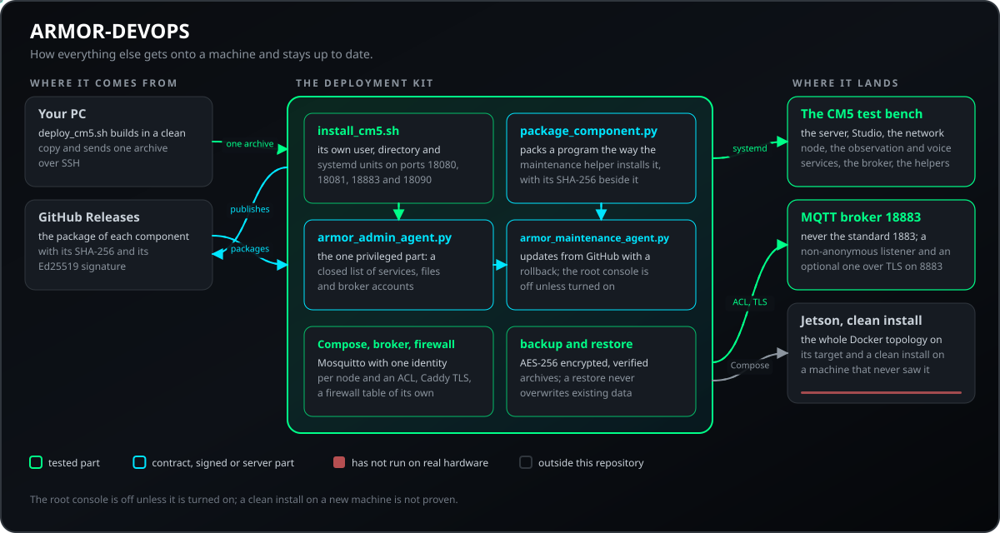
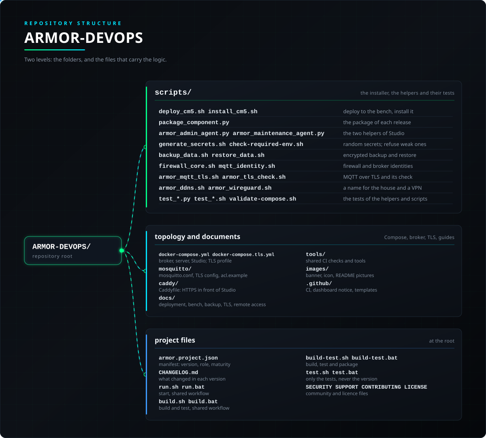

<p align="center">
  
</p>

# 🚀 ARMOR-DEVOPS

<p align="center">
  <a href="README.md">🇺🇸 English</a> |
  <a href="README_spa.md">🇪🇸 Español</a> |
  <a href="README_fra.md">🇫🇷 Français</a> |
  🇮🇹 <b>Italiano</b> |
  <a href="README_deu.md">🇩🇪 Deutsch</a> |
  <a href="README_zho.md">🇨🇳 简体中文</a> |
  <a href="README_jpn.md">🇯🇵 日本語</a> |
  <a href="README_por.md">🇵🇹 Português</a>
</p>

### Distribuzione, il banco di prova CM5, i suoi aggiornamenti da GitHub e la manutenzione dell'impianto

<p align="center">
  
  
  
  
  
</p>

---

**Controllo di onestà - cosa funziona oggi:** L'installatore del banco CM5 è stato eseguito su una vera CM5 che ospita altro software, rimasto sano, e il banco funziona in uso quotidiano con il server, Studio, il nodo di rete, i servizi di osservazione e di voce, il broker e i due assistenti qui sotto; vi sono stati fatti aggiornamenti dei suoi componenti da GitHub (tramite Studio). La topologia Docker Compose e il suo profilo TLS opzionale sono stati costruiti ed eseguiti davvero con Docker Engine in WSL (`scripts/test_compose.sh`), ma **non sul Jetson**. Gli script di backup e ripristino hanno un test di andata e ritorno che passa, e i due assistenti hanno i propri test. Ciò che **non** è provato: un'installazione pulita su una macchina che non ha mai visto il progetto e l'intera topologia Docker sulla sua destinazione.

---

## 📋 In breve

| | |
|---|---|
| Versione | `0.6.7` |
| Maturità | Consolidato |
| Ruolo | Kit di distribuzione: installatore del banco CM5, pacchetti di rilascio, due assistenti, topologia Compose |
| Tecnologia | Bash, Python 3 (libreria standard), Docker Compose, Mosquitto, Caddy, nginx, systemd |
| Test | Uno script di test per ogni parte (`scripts/test_*.sh` e `test_*.py`); la topologia Compose è costruita ed eseguita con Docker in WSL |
| Contratto | Porte del banco: server 18080, Studio 18081, MQTT 18883 (mai 1883), voce 18090 |
| Gira su | Una CM5 o qualsiasi macchina Debian raggiungibile via SSH; Docker Engine con Compose per la topologia a container |
| Su hardware reale | Governa il banco di prova CM5 in uso quotidiano, su una vera CM5 che ospita altro software; non ancora sul Jetson |
| Licenza | GPL-3.0-or-later |

**Vai a:** [Panoramica](#-panoramica) · [Architettura](#-architettura) · [Sicurezza](#-sicurezza-e-protezione) · [Interfacce](#-interfacce) · [Configurazione](#-configurazione) · [Avvio rapido](#-avvio-rapido) · [Test](#-test) · [Problemi](#-risoluzione-dei-problemi) · [Struttura](#-struttura-del-repository) · [Correlati](#-progetti-correlati)

## 🚦 Stato del progetto

Ogni riga è una parte di questo repository e il semaforo dice a che punto è oggi. È scritta in base a ciò che il repository può mostrare (test, compilazioni, esecuzioni), non a ciò che è previsto.

🟢 Fatto e verificato · 🟡 Funziona, con limiti noti · 🟠 Fatto a metà o non ancora verificato · 🔴 Non fatto o non funzionante

| Area | Stato | Cosa significa qui |
|---|---|---|
| Software | 🟡 | L'installatore del banco CM5 è stato eseguito su una CM5 reale che ospita altro software, rimasto in salute; un'installazione pulita su una macchina che non ha mai visto il progetto non è provata. |
| Test | 🟡 | Gli script di backup e ripristino hanno un test di andata e ritorno che passa, i due assistenti hanno i propri test e la topologia Docker con il profilo TLS opzionale è stata costruita ed eseguita con Docker Engine in WSL; la topologia completa non ha girato sulla sua destinazione. |
| Hardware | 🟡 | Gestisce il banco di prova CM5 in uso quotidiano; nulla ha girato sulla Jetson. |
| Aggiornamenti | 🟢 | Gli aggiornamenti dei componenti da GitHub, tramite Studio, sono stati eseguiti sul banco di prova CM5. |
| Documentazione | 🟢 | Otto lingue e il registro delle modifiche sono aggiornati. |

## 🎯 Panoramica

* **Banco di prova CM5:** `scripts/deploy_cm5.sh` compila in una copia pulita, invia un archivio ed esegue `scripts/install_cm5.sh`, che crea il proprio utente, la propria directory e unità systemd su porte proprie per il server e Studio e, con opzioni, il broker MQTT, il nodo di rete, il servizio di osservazione, il gateway vocale, l'agente di amministrazione, l'assistente di manutenzione e il backup giornaliero. Non tocca mai ciò che la macchina esegue per altro.
* **L'assistente di manutenzione** (`armor_maintenance_agent.py`): gli aggiornamenti dei componenti dell'impianto da GitHub (scarica il pacchetto della versione, controlla il suo SHA-256 e lo sostituisce con ripristino), quelli del sistema operativo e una console root facoltativa, tutto guidato dalla scheda *Aggiornamenti* di Studio; la console è spenta salvo attivazione. Conserva le sei copie più recenti che mette da parte, e meno quando il disco è quasi pieno (`ARMOR_MAINT_MIN_FREE_MB` nel suo file di impostazioni: 500 per impostazione predefinita, 0 lo disattiva).
* **L'agente di amministrazione** (`armor_admin_agent.py`): l'unica parte privilegiata, con un elenco chiuso di servizi, file di impostazioni e account del broker, così Studio non ha mai bisogno di root.
* **Pacchetti di ogni versione:** `scripts/package_component.py` costruisce il pacchetto di un componente (Studio, server, rete, servizio di osservazione, gateway vocale, DevOps), scrive il suo SHA-256 accanto e lo pubblica come release GitHub.
* **Topologia Compose:** un broker Mosquitto non anonimo con un'identità per nodo e una ACL (compresi i nodi d'allarme e le zone Zigbee che il server dice loro), il server e Studio dietro un nginx che fa da proxy di `/api/`; solo Studio è pubblicato, su loopback. Container rinforzati, immagini fissate, una rete interna del nucleo e volumi con nome per lo stato.
* **TLS:** un profilo `tls` facoltativo di Compose mette Caddy, con la propria autorità di certificazione locale, davanti a Studio, ed è fornita una configurazione Mosquitto su TLS ([dettagli](docs/BACKUP_AND_TLS.md)).
* **Un firewall di host per la macchina centrale** (`scripts/firewall_core.sh`): la porta del broker solo dalla rete di campo, quelle del server e di Studio solo dalla rete dei client (quando data), in una tabella propria che non menziona nient'altro.
* **Segreti:** `scripts/generate_secrets.sh` crea segreti casuali e non ne stampa nessuno; `scripts/check-required-env.sh` rifiuta valori mancanti, di esempio, corti o ripetuti.
* **Backup e ripristino:** `scripts/backup_data.sh` produce un archivio cifrato AES-256, verificato e con checksum dei dati del server (prove escluse salvo richiesta); `scripts/restore_data.sh` lo elenca o lo ripristina senza mai sovrascrivere dati esistenti.
* **Una VPN e un nome per la casa, configurati da Studio:** `armor_wireguard.sh` crea una VPN WireGuard con pochi comandi (chiavi sulla macchina, una configurazione per telefono con codice QR, instradamento verso i nodi se serve) e `armor_ddns.sh` mantiene un nome DuckDNS, Cloudflare o altro puntato alla casa quando l'operatore cambia l'indirizzo; l'agente di manutenzione offre entrambi a Studio e al telefono, quindi nessuno deve digitare un comando, e una guida passo passo in otto lingue copre il router.
* **Pacchetti firmati:** l'assistente di manutenzione installa un pacchetto del server, di Studio o di un altro programma solo se porta una firma Ed25519 valida della chiave di rilascio del progetto (verificata in puro Python, senza software aggiuntivo); una firma assente, errata o manomessa lascia la macchina invariata. Una deroga d'emergenza esiste solo come impostazione nel file della macchina stessa.
* **Una porta cifrata facoltativa verso il broker (MQTT su TLS):** `scripts/armor_mqtt_tls.sh` crea un'autorità di certificazione per l'installazione (la sua chiave resta sulla macchina, modo `0600`), un certificato del broker per i nomi e gli indirizzi della macchina e un secondo listener Mosquitto sull'8883 accanto a quello normale, che non tocca mai; è idempotente e ha `status`, `export-ca`, `server-tls` e `remove` (i file vengono messi da parte, mai cancellati). Provato con OpenSSL, con veri handshake, e su un vero Mosquitto 2.0 ([guida](docs/MQTT_TLS_ita.md)).
* **Rapporti di salute consentiti:** le regole del broker lasciano a ogni nodo scrivere il proprio `armor/health/<nodo>` e al server leggere `armor/health/#`; `mqtt_identity.sh add` scrive la riga per ogni tipo di nodo e `mqtt_identity.sh health-report <ruolo> <nodo>` la aggiunge a un nodo installato prima (idempotente, le regole precedenti vengono conservate).
* **Regole del broker per il controllo dei nodi:** solo l'identità del server può pubblicare su `armor/control/+/command` (che copre `armor/control/all/command`); ogni nodo legge il proprio argomento di ordini e quello di diffusione e scrive la propria risposta su `armor/control/<nodo>/result`, e nient'altro, così nessun nodo può comandarne un altro e la password rubata di un nodo non può riavviare gli altri. `mqtt_identity.sh node-control` aggiunge le tre righe a un nodo installato prima, e il test delle ACL controlla ogni tipo di nodo.

## 🧩 Ruolo in A.R.M.O.R.

ARMOR-DEVOPS è il modo in cui tutto il resto arriva su una macchina e resta aggiornato. Installa il server, Studio, il nodo di rete, i servizi di osservazione e di voce e il broker sul banco di prova CM5, fa i pacchetti di ogni versione che la scheda *Aggiornamenti* di [ARMOR-STUDIO](https://github.com/JuanenRac/ARMOR-STUDIO) installa da GitHub, e tiene i due piccoli assistenti che permettono a Studio di aggiornare l'impianto e gestire i suoi servizi senza mai girare come root.

| Parla con | Come | A che scopo |
|---|---|---|
| ARMOR-STUDIO | la sua scheda *Aggiornamenti* interroga l'assistente di manutenzione tramite un socket locale | non ha mai bisogno di root |
| GitHub Releases | `package_component.py` pubblica il pacchetto con SHA-256 e firma | i componenti da installare |
| ARMOR-SERVER, ARMOR-NETWORK, ARMOR-SERVER-AI, ARMOR-VOICE-AI | installati come unità systemd proprie | i servizi del banco |
| ARMOR-UPDATER | separato | lo strumento di chi tiene una copia della famiglia su un PC; questo repository è per la CM5 e la topologia Compose |

## 🏛️ Architettura

<p align="center">
  
</p>

## 🔒 Sicurezza e protezione

| Minaccia | Difesa |
|---|---|
| Interferire con altro software della CM5 | Utente, cartella e porte proprie (server 18080, Studio 18081, MQTT 18883 e voce 18090, tutte tra 1024 e 65535 e diverse, mai la standard 1883); non tocca il firewall di sistema |
| Un broker aperto o non autenticato | `allow_anonymous false`, un file di password e una ACL (segreti montati in `/run/secrets`), un'identità per nodo; solo il server può pubblicare `armor/control/+/command`; ogni nodo legge il proprio comando e quello di diffusione e scrive solo il proprio `armor/control/<nodo>/result` e `armor/health/<nodo>`; il server legge `armor/health/#` |
| Ascolto accidentale in rete | Compose pubblica il broker e Studio solo su `127.0.0.1` salvo che `ARMOR_MQTT_BIND`, `ARMOR_STUDIO_BIND` (e `ARMOR_TLS_BIND` per Caddy) dicano altro |
| MQTT e Studio in chiaro | Facoltativo: un secondo listener Mosquitto su 8883 accanto a quello semplice (`armor_mqtt_tls.sh`: autorità propria, chiave in modo `0600`, certificato per i nomi della macchina, idempotente, non tocca mai quello semplice) e un profilo `tls` di Compose con Caddy e la sua autorità locale |
| La macchina centrale aperta a tutti | `firewall_core.sh` scrive una tabella propria (`/etc/armor/firewall.nft`, con un'unità di ripristino): la porta del broker solo dalla rete di campo, quelle di server e Studio solo dalla rete dei client; `check` la verifica con `nft -c` |
| Segreti deboli o stampati | `generate_secrets.sh` crea segreti casuali e non ne stampa alcuno; `check-required-env.sh` rifiuta valori mancanti, segnaposto, corti o ripetuti |
| Un backup rubato | `backup_data.sh` crea un archivio cifrato AES-256, verificato e con checksum (prove escluse salvo richiesta); `restore_data.sh` lo elenca o lo ripristina senza mai sovrascrivere dati esistenti |
| Un falso aggiornamento di un componente | L'assistente di manutenzione scarica il pacchetto di rilascio, verifica il suo SHA-256 e la firma Ed25519 della chiave di rilascio del progetto (in Python puro) e lo sostituisce con ripristino; una firma mancante, errata o manomessa lascia la macchina invariata |
| Root raggiungibile da Studio | Mai necessario: l'agente di amministrazione (`armor_admin_agent.py`) ha un elenco chiuso di servizi, file di impostazioni e account del broker; la console root dell'assistente di manutenzione è spenta salvo attivazione |

I container sono rinforzati, le immagini fissate, la rete `core` è interna e lo stato sta in volumi con nome. I due assistenti usano socket Unix locali, quindi i loro test richiedono Linux. Un'installazione pulita su una macchina che non ha mai visto il progetto e l'intera topologia Docker sulla sua destinazione non sono provate; non c'è stata una revisione indipendente.

## 🔌 Interfacce

| Rotta | Autenticazione | Cosa fa |
|---|---|---|
| `scripts/deploy_cm5.sh --host <cm5> --user <user> --key <key> --apply` | - | compila in una copia pulita, invia un archivio via SSH ed esegue `install_cm5.sh` |
| `scripts/install_cm5.sh --public-host HOST [--apply]` | - | crea utente, cartella e unità systemd; `--server-port`, `--studio-port`, `--mqtt-port` e `--also-reach` lo regolano; senza `--apply` mostra solo il piano |
| `scripts/package_component.py` | - | impacchetta Studio, il server, il nodo di rete, il servizio di osservazione, il gateway vocale o DevOps come lo installa l'assistente di manutenzione, scrive il suo SHA-256 e lo pubblica come rilascio GitHub |
| `scripts/generate_secrets.sh`  `scripts/check-required-env.sh` | - | `.env` e `secrets/` (ignorati da Git); il controllo rifiuta valori mancanti, segnaposto, corti o ripetuti |
| `scripts/backup_data.sh --data-dir <d> --out-dir <o> --passphrase-file <f>` | - | l'archivio cifrato e verificato dei dati del server |
| `scripts/restore_data.sh` | - | elenca un archivio o lo ripristina senza sovrascrivere dati esistenti |
| `scripts/firewall_core.sh apply, check --field <net> [--clients <net>]` | - | la tabella firewall della macchina centrale; `check` la verifica (`FIREWALL_CHECK=SKIP` se `nft` non è installato) |
| `scripts/mqtt_identity.sh add`  `health-report <role> <node>`  `node-control` | - | scrive la riga del broker di ogni tipo di nodo; aggiunge rapporti di salute e controllo a un nodo installato prima (idempotente) |
| `scripts/armor_mqtt_tls.sh`  `armor_wireguard.sh`  `armor_ddns.sh`  `armor_tls_check.sh` | - | la porta cifrata del broker (`status`, `export-ca`, `server-tls`...), la VPN WireGuard con un QR per telefono, un nome DuckDNS, Cloudflare o altro per la casa e il controllo dell'accesso remoto; Studio li offre senza digitare comandi |

I due assistenti (`armor_admin_agent.py`, `armor_maintenance_agent.py`) ascoltano su socket Unix locali e quindi non funzionano su Windows. Il file Compose avvia il broker (Mosquitto), il server e Studio (nginx, che inoltra `/api/`), e un profilo `tls` aggiunge Caddy; si pubblica solo Studio, di default su loopback (`127.0.0.1:8088`, TLS su 8443). I pacchetti di ogni rilascio sono asset dei rilasci GitHub, non file di questo repository.

## ⚙️ Configurazione

| Impostazione | Predefinito | Cosa fa |
|---|---|---|
| `install_cm5.sh` | 18080  18081  18883  18090 | `--server-port`, `--studio-port`, `--mqtt-port` (si non ripetuto resta quello installato) e la porta voce; tutte tra 1024 e 65535 e diverse; l'indirizzo del broker va in `PREFIX/etc/armor.mqtt.env` |
| `ARMOR_MQTT_BIND`  `ARMOR_STUDIO_BIND` | 127.0.0.1 | dove Compose pubblica il broker e Studio |
| `ARMOR_PUBLIC_ORIGIN` | http://127.0.0.1:8088 | l'origine con cui si raggiunge Studio |
| `ARMOR_TLS_BIND`  `ARMOR_TLS_PORT`  `ARMOR_TLS_HTTP_PORT` | 8443 | Caddy del profilo `tls` |
| `.env`  `.env.example` | - | creato da `generate_secrets.sh`, ignorato da Git; l'esempio elenca ogni variabile |

La console root dell'assistente di manutenzione è un'impostazione del file della macchina ed è spenta di default; firewall e TLS sono opzioni dell'installatore, non valori predefiniti. Dettagli in [docs/CM5_TEST_BENCH.md](docs/CM5_TEST_BENCH.md).

## 🚀 Avvio rapido

**Requisiti:** Docker Engine con Compose (per la topologia a container), una CM5 o qualsiasi macchina Debian raggiungibile via SSH (per il banco di prova), Bash, `ssh` e `tar` sulla macchina che distribuisce.

```bash
scripts/generate_secrets.sh                                                            # `.env` e `secrets/` (ignorati da Git)
scripts/check-required-env.sh
docker compose config --quiet && docker compose up --build                             # la topologia a container
scripts/deploy_cm5.sh --host <cm5> --user <user> --key <key> --apply                   # il banco di prova
scripts/backup_data.sh --data-dir <data> --out-dir <backups> --passphrase-file <file>  # un backup cifrato
```

Vedi il [confine della distribuzione](docs/DEPLOYMENT_BOUNDARY.md) e il [banco di prova](docs/CM5_TEST_BENCH.md).

## 🧪 Test

| Area | Cosa copre |
|---|---|
| `test_admin_agent.py`  `.sh` | l'elenco chiuso dell'agente di amministrazione (richiede Linux: socket Unix) |
| `test_maintenance_agent.py`  `.sh` | l'assistente di manutenzione: scaricamento, SHA-256, firma, sostituzione e ripristino (richiede Linux) |
| `test_package_component.py`  `test_registry.py`  `test_remote_access.py` | i pacchetti, l'elenco dei componenti e gli assistenti dell'accesso remoto |
| `test_backup.sh`  `test_env_and_restore.sh` | l'andata e ritorno di backup e ripristino, i segreti e il controllo dell'ambiente |
| `test_compose.sh`  `validate-compose.sh` | la topologia Compose e il suo profilo TLS, costruite ed eseguite con Docker Engine in WSL |
| `test_firewall.sh`  `test_install_plan.sh`  `test_mqtt_identity.sh`  `test_mqtt_tls.sh`  `test_tls_check.sh`  `test_wireguard.sh`  `test_ddns.sh` | il firewall, il piano dell'installatore, le identità del broker, MQTT su TLS, il controllo TLS, la VPN e il nome dinamico |

I test Python si eseguono con `python -m unittest discover -s scripts -p "test_*.py"`; su Windows i tre che richiedono socket Unix non possono girare. Gli script richiedono Bash, WSL, Docker o root e vanno eseguiti su Linux. Non c'è ancora un numero unico di test: Project status dice cosa è stato eseguito. GitHub Actions esegue la base A.R.M.O.R. a ogni push e pull request: la validazione di manifesto, versione, registro delle modifiche e parità dei README, poi la compilazione e i test del progetto.

## 🏗️ Compilazione e rilascio

Non si compila nulla: sono script, un file Compose e assistenti Python. `scripts/package_component.py` costruisce il pacchetto di un componente e scrive accanto il suo SHA-256; i pacchetti sono asset dei rilasci GitHub, non file di questo repository. La versione risiede in `armor.project.json` e nel badge del README (letto dal manifesto); ogni versione ha la sua voce in [CHANGELOG.md](CHANGELOG.md).

## 🩺 Risoluzione dei problemi

| Vedi | Perché | Fai |
|---|---|---|
| `ports must be numbers between 1024 and 65535`  `the server and studio ports must differ` | una porta di `install_cm5.sh` è fuori intervallo o ripetuta | usa porte diverse tra 1024 e 65535 (mai la standard 1883) |
| `--also-reach must look like http://HOST:PORT=http://HOST:PORT` | l'indirizzo aggiuntivo non è scritto come indirizzo di Studio = indirizzo del server | scrivi `--also-reach http://<host>:<porta-studio>=http://<host>:<porta-server>` |
| `FIREWALL_CHECK=SKIP nft is not installed here` | manca `nft`, quindi `firewall_core.sh check` non può verificare la tabella | installa nftables sulla macchina e ricontrolla |
| `AttributeError: module 'socketserver' has no attribute 'UnixStreamServer'` | i test dei due assistenti sono eseguiti su Windows | eseguili su Linux (o WSL) |

## 📂 Struttura del repository

<p align="center">
  
</p>

<details>
<summary>Versione testuale dell'albero</summary>

```text
ARMOR-DEVOPS/
├── scripts/
│   ├── deploy_cm5.sh install_cm5.sh                      distribuisce sul banco, lo installa
│   ├── package_component.py                              il pacchetto di ogni rilascio
│   ├── armor_admin_agent.py armor_maintenance_agent.py   i due assistenti di Studio
│   ├── generate_secrets.sh check-required-env.sh         segreti casuali; rifiuta i deboli
│   ├── backup_data.sh restore_data.sh                    backup cifrato e ripristino
│   ├── firewall_core.sh mqtt_identity.sh                 firewall e identità del broker
│   ├── armor_mqtt_tls.sh armor_tls_check.sh              MQTT su TLS e il suo controllo
│   ├── armor_ddns.sh armor_wireguard.sh                  un nome per la casa e una VPN
│   └── test_*.py test_*.sh validate-compose.sh           i test degli assistenti e degli script
├── docker-compose.yml docker-compose.tls.yml             broker, server, Studio; profilo TLS
├── mosquitto/                                            mosquitto.conf, config TLS, acl.example
├── caddy/                                                Caddyfile: HTTPS davanti a Studio
├── docs/                                                 DEPLOYMENT_BOUNDARY, CM5_TEST_BENCH, BENCH_TESTS, BACKUP_AND_TLS, MQTT_TLS, HTTPS_PAIRING, REMOTE_ACCESS, SIGNED_PACKAGES (quattro anche in otto lingue)
├── tools/                                                i controlli CI e gli strumenti condivisi
├── images/                                               banner, icona e immagini del README
├── .github/                                              workflow CI, avviso alla dashboard, modelli per issue e pull request
├── armor.project.json                                    manifesto: versione, ruolo, maturità
├── CHANGELOG.md                                          cosa è cambiato in ogni versione
├── run.sh run.bat                                        avvio, flusso condiviso
├── build.sh build.bat                                    compila e prova, flusso condiviso
├── build-test.sh build-test.bat                          compila, prova e impacchetta
├── test.sh test.bat                                      solo i test, mai la versione
└── SECURITY.md SUPPORT.md CONTRIBUTING.md CODE_OF_CONDUCT.md LICENSE
```

</details>

## 🗺️ Roadmap e limiti noti

**Limiti noti oggi**

* Un'installazione pulita su una macchina che non ha mai visto il progetto non è provata.
* L'intera topologia Docker è stata costruita ed eseguita con Docker Engine in WSL, ma non sulla sua destinazione, il Jetson.
* Non c'è un numero unico di test e i test dei due assistenti richiedono Linux.
* Nessuna revisione di sicurezza indipendente.

**Prossimi passi**

* Un'installazione pulita su una macchina nuova e la topologia Docker sul Jetson.

## 🌍 Lingue

Il README e i testi esistono in inglese, spagnolo, francese, italiano, tedesco, cinese, giapponese e portoghese europeo.

## 🔗 Progetti correlati

**A.R.M.O.R.** (Autonomous Radar & Multimodal Observation Range) è un sistema di sicurezza perimetrale fatto di repository indipendenti. Ognuno ha la propria versione, i propri test e il proprio README; ecco la famiglia:

* **[ARMOR-COMMON](https://github.com/JuanenRac/ARMOR-COMMON)** - Contratti dei messaggi, validatori, vettori di conformità e tipi generati
* **[ARMOR-NODE-RADAR](https://github.com/JuanenRac/ARMOR-NODE-RADAR)** - Firmware del nodo di campo per ESP32-S3 con tre radar e un proprio pannello web
* **[ARMOR-NODE-SOLAR](https://github.com/JuanenRac/ARMOR-NODE-SOLAR)** - Protocolli di inverter e batterie solari e messaggi di un nodo gateway
* **[ARMOR-NODE-ELECTRICAL](https://github.com/JuanenRac/ARMOR-NODE-ELECTRICAL)** - Nodo elettrico: contatori, il messaggio delle letture della rete e le regole di manovra
* **[ARMOR-NODE-ALARM](https://github.com/JuanenRac/ARMOR-NODE-ALARM)** - Nodo e centrale d'allarme: zone, inserimento, ritardi, sirena e PIN, con il server o senza
* **[ARMOR-NODE-HMI](https://github.com/JuanenRac/ARMOR-NODE-HMI)** - Pannello touch: lo stato del sistema su uno schermo a parete, attivare e riconoscere gli allarmi, e la casa dell'assistente vocale
* **[ARMOR-NETWORK](https://github.com/JuanenRac/ARMOR-NETWORK)** - La rete locale: i suoi dispositivi, internet e ciò che cambia
* **[ARMOR-SERVER](https://github.com/JuanenRac/ARMOR-SERVER)** - Coordinatore centrale: telemetria, allarmi, dispositivi, letture solari e telecamere
* **[ARMOR-STUDIO](https://github.com/JuanenRac/ARMOR-STUDIO)** - Console web: telecamere, radar, allarmi, energia solare e progettista del sito 2D/3D
* **[ARMOR-ANDROID-CONTROL](https://github.com/JuanenRac/ARMOR-ANDROID-CONTROL)** - Client Android dell'operatore con radar 2D/3D in tempo reale
* **[ARMOR-IOS-CONTROL](https://github.com/JuanenRac/ARMOR-IOS-CONTROL)** - Client operatore per iPhone
* **[ARMOR-SERVER-AI](https://github.com/JuanenRac/ARMOR-SERVER-AI)** - Politica di inferenza visiva che spiega le sue decisioni e non agisce mai
* **[ARMOR-VISION](https://github.com/JuanenRac/ARMOR-VISION)** - Zone delle telecamere, maschere e regole di rilevamento per la Jetson Orin NX
* **[ARMOR-VOICE-AI](https://github.com/JuanenRac/ARMOR-VOICE-AI)** - Intenti vocali offline con una conferma impossibile da falsificare
* **[ARMOR-HARDWARE](https://github.com/JuanenRac/ARMOR-HARDWARE)** - Contenitori, elettronica e matrice di accettazione da banco
* **ARMOR-DEVOPS** (questo repository) - Distribuzione, banco di prova CM5, backup e TLS
* **[ARMOR-SIMULATOR](https://github.com/JuanenRac/ARMOR-SIMULATOR)** - Simulatore di telemetria offline con guasti ripetibili
* **[ARMOR-UPDATER](https://github.com/JuanenRac/ARMOR-UPDATER)** - Rileva, installa e aggiorna i repository stessi dell'ecosistema
* **[ARMOR-DOCS](https://github.com/JuanenRac/ARMOR-DOCS)** - Architettura, base di sicurezza e matrice delle capacità

## 📚 Documentazione

* [DEPLOYMENT_BOUNDARY](docs/DEPLOYMENT_BOUNDARY.md): cosa distribuisce questo repository e cosa no
* [CM5_TEST_BENCH](docs/CM5_TEST_BENCH.md): l'installatore, le unità, le porte e gli assistenti del banco
* [BENCH_TESTS](docs/BENCH_TESTS.md): come si prova il banco
* [BACKUP_AND_TLS](docs/BACKUP_AND_TLS.md): backup e ripristino, e il profilo TLS di Compose
* [MQTT_TLS](docs/MQTT_TLS.md): la porta cifrata del broker (anche in otto lingue)
* [HTTPS_PAIRING](docs/HTTPS_PAIRING.md): fidarsi del certificato di un nodo (anche in otto lingue)
* [REMOTE_ACCESS](docs/REMOTE_ACCESS.md): VPN, un nome per la casa e il router, passo dopo passo (anche in otto lingue)
* [SIGNED_PACKAGES](docs/SIGNED_PACKAGES.md): la firma dei pacchetti (anche in otto lingue)
* [Matrice delle capacità: cosa è provato e cosa no](https://github.com/JuanenRac/ARMOR-DOCS/blob/main/docs/CAPABILITY_MATRIX.md)
* [Catalogo dei progetti: versioni e dipendenze tra i repository](https://github.com/JuanenRac/ARMOR-DOCS/blob/main/docs/PROJECT_CATALOG.md)
* [Cronologia delle modifiche di questo repository](CHANGELOG.md)

## 🤝 Contribuire e comunità

* Prima di una pull request esegui `python -I tools/armor_ci_validate.py` e i test: devono passare entrambi. Vedi [CONTRIBUTING.md](CONTRIBUTING.md) e il [codice di condotta](CODE_OF_CONDUCT.md).
* Il README esiste in otto lingue ed è generato dalle sorgenti in ARMOR-DOCS: una modifica al testo si fa lì.
* Una modifica a un messaggio tra componenti parte da ARMOR-COMMON.
* Non descrivere come funzionante su una scheda ciò che è stato solo compilato.
* Segnala una vulnerabilità in privato: [SECURITY.md](SECURITY.md). Domande, idee e segnalazioni: electrohobby3d@gmail.com ([SUPPORT.md](SUPPORT.md)).

## 👤 AUTORE

**JuanenRac (Electro Hobby 3D)** · electrohobby3d@gmail.com

## 📜 LICENZA

GPL-3.0-or-later - vedi [LICENSE](LICENSE).
